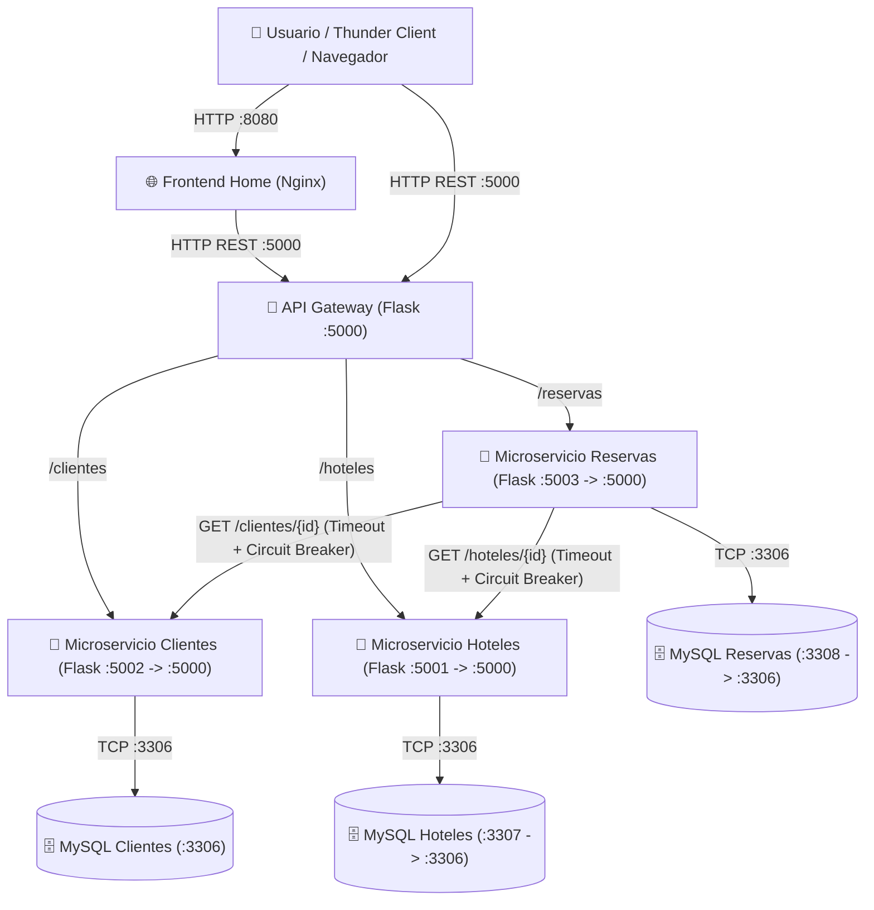

#  Sistema de Gestión Hotelera y Reservas (HotelRes)

Arquitectura distribuida basada en **microservicios independientes**, orquestados mediante **Docker Compose**, con un **API Gateway** como punto único de entrada y mecanismos de resiliencia (**Timeouts** y **Circuit Breaker**).

---

## 1. Descripción del sistema

| Aspecto | Detalle |
| :--- | :--- |
| **Problema que resuelve** | Evita el acoplamiento monolítico en la gestión de reservas hoteleras, aislando el dominio de clientes, el catálogo de hoteles y la lógica de reservaciones para permitir escalabilidad, persistencia independiente y tolerancia a fallos ante caídas o lentitud de servicios. |
| **Funcionalidades principales** | • Registro, consulta, actualización y eliminación (CRUD) de **Clientes**.<br>• Administración y consulta CRUD de **Hoteles**.<br>• Creación y gestión de **Reservas** con validación remota de existencia de cliente y hotel.<br>• Consulta consolidada del detalle de una reserva (`/reservas/{id}/detalle`).<br>• Monitoreo en tiempo real del estado del **Circuit Breaker** (`/reservas/circuito`).<br>• Interfaz web estática (`home`) conectada exclusivamente al **API Gateway**. |

---

## 2. Arquitectura completa



---

## 3. Microservicios y componentes

| Componente / Servicio | Puerto Host : Contenedor | Responsabilidad | Funcionalidad implementada |
| :--- | :--- | :--- | :--- |
| **API Gateway** (`gateway`) | `5000:5000` | Punto único de entrada y enrutamiento HTTP. | Enruta peticiones hacia `clientes`, `hoteles` y `reservas`; reenvía métodos `GET`, `POST`, `PUT`, `DELETE`, `OPTIONS`; conserva códigos de estado; gestiona CORS, `Timeout` (`504`) y `ConnectionError` (`503`). |
| **Clientes** (`clientes`) | `5002:5000` | Gestión del ciclo de vida de los clientes. | Operaciones CRUD sobre la entidad `clientes` y exposición de datos para validación desde `reservas`. |
| **Hoteles** (`hoteles`) | `5001:5000` | Administración del catálogo de alojamientos. | Operaciones CRUD sobre la entidad `hoteles` (`hotel`, `ciudad`, `direccion`). |
| **Reservas** (`reservas`) | `5003:5000` | Orquestación y registro de reservaciones. | CRUD de reservas, validación remota de cliente y hotel protegida con **Timeout** y **Circuit Breaker** (`pybreaker`), endpoint de detalle consolidado y endpoint de estado del circuito. |
| **Frontend Home** (`home`) | `8080:80` | Interfaz de usuario web. | Aplicación estática servida con Nginx (`index.html`, `style.css`, `script.js`) que consume `http://localhost:5000` para operar clientes, hoteles y reservas. |

---

## 4. Endpoints

Todas las peticiones externas se consumen a través del API Gateway en `http://localhost:5000`.

### 4.1. Servicio Clientes (`/clientes`)

| Método | Ruta | Datos de entrada (JSON) | Respuesta esperada |
| :--- | :--- | :--- | :--- |
| `GET` | `/clientes` | Ninguno | `200 OK` — Lista JSON de clientes registrados. |
| `GET` | `/clientes/{id}` | Ninguno (`id` en URL) | `200 OK` — Objeto JSON del cliente / `404 Not Found`. |
| `POST` | `/clientes` | `{"nombre": "daniel"}` | `201 Created` — Confirmación e `id` del cliente creado. |
| `PUT` | `/clientes/{id}` | `{"nombre": "Daniel Gómez"}` | `200 OK` — Confirmación de actualización / `404 Not Found`. |
| `DELETE` | `/clientes/{id}` | Ninguno (`id` en URL) | `200 OK` — Confirmación de eliminación / `404 Not Found`. |

### 4.2. Servicio Hoteles (`/hoteles`)

| Método | Ruta | Datos de entrada (JSON) | Respuesta esperada |
| :--- | :--- | :--- | :--- |
| `GET` | `/hoteles` | Ninguno | `200 OK` — Lista JSON de hoteles (`id`, `hotel`, `ciudad`, `direccion`). |
| `GET` | `/hoteles/{id}` | Ninguno (`id` en URL) | `200 OK` — Objeto JSON del hotel / `404 Not Found`. |
| `POST` | `/hoteles` | `{"hotel": "Hotel Paraíso", "ciudad": "Cartagena", "direccion": "Avenida 1 de Mayo"}` | `201 Created` — Confirmación e `id` del hotel creado. |
| `PUT` | `/hoteles/{id}` | Campos a actualizar (`hotel`, `ciudad`, `direccion`) | `200 OK` — Confirmación de actualización / `404 Not Found`. |
| `DELETE` | `/hoteles/{id}` | Ninguno (`id` en URL) | `200 OK` — Confirmación de eliminación / `404 Not Found`. |

### 4.3. Servicio Reservas (`/reservas`)

| Método | Ruta | Datos de entrada (JSON) | Respuesta esperada |
| :--- | :--- | :--- | :--- |
| `GET` | `/reservas` | Ninguno | `200 OK` — Lista JSON de todas las reservas. |
| `GET` | `/reservas/{id}` | Ninguno (`id` en URL) | `200 OK` — Objeto JSON de la reserva / `404 Not Found`. |
| `GET` | `/reservas/{id}/detalle` | Ninguno (`id` en URL) | `200 OK` — JSON consolidado con datos de reserva, nombre del cliente y datos del hotel. |
| `GET` | `/reservas/circuito` | Ninguno | `200 OK` — Estado actual (`CLOSED`, `OPEN`, `HALF_OPEN`), fallos consecutivos, umbral y tiempo de recuperación para `clientes` y `hoteles`. |
| `POST` | `/reservas` | `{"cliente_id": 1, "hotel_id": 1, "fecha_entrada": "2026-12-10", "fecha_salida": "2026-12-15", "estado": "CONFIRMADA"}` | `201 Created` — `{"mensaje": "Reserva creada", "id": 1}` / `400`, `404`, `503` o `504`. |
| `PUT` | `/reservas/{id}` | Campos a actualizar (`cliente_id`, `hotel_id`, `fecha_entrada`, `fecha_salida`, `estado`) | `200 OK` — `{"mensaje": "Reserva actualizada"}` / `404 Not Found`. |
| `DELETE` | `/reservas/{id}` | Ninguno (`id` en URL) | `200 OK` — `{"mensaje": "Reserva eliminada"}` / `404 Not Found`. |

---

## 5. Bases de datos

Cada microservicio de negocio posee su propia instancia aislada de **MySQL** (*Database-per-Service*):

| Microservicio | Motor y Contenedor | Nombre de BD | Puerto Host : Contenedor | Tablas principales y columnas |
| :--- | :--- | :--- | :--- | :--- |
| **Clientes** | MySQL (`mysql_clientes`) | `clientes` | `3306:3306` | **`clientes`**: `id` (PK, AI), `nombre` (y campos de contacto). |
| **Hoteles** | MySQL (`mysql_hoteles`) | `hoteles` | `3307:3306` | **`hoteles`**: `id` (PK, AI), `hotel`, `ciudad`, `direccion`. |
| **Reservas** | MySQL (`mysql_reservas`) | `reservas` | `3308:3306` | **`reservas`**: `id` (PK, AI), `cliente_id`, `hotel_id`, `fecha_entrada`, `fecha_salida`, `estado`. |

---

## 6. Persistencia

El almacenamiento de datos se gestiona mediante **volúmenes nombrados de Docker**, garantizando que los registros sobrevivan al reinicio o recreación de los contenedores:

| Contenedor de Base de Datos | Volumen Docker | Ruta montada en contenedor | Propósito |
| :--- | :--- | :--- | :--- |
| `mysql_clientes` | `mysql_clientes_data` | `/var/lib/mysql` | Persistencia de registros de clientes. |
| `mysql_hoteles` | `mysql_hoteles_data` | `/var/lib/mysql` | Persistencia del catálogo de hoteles. |
| `mysql_reservas` | `mysql_reservas_data` | `/var/lib/mysql` | Persistencia del historial de reservas. |

---

## 7. Comunicación entre servicios

Todas las comunicaciones síncronas viajan por la red interna privada creada por Docker Compose resolviendo los contenedores por su nombre de servicio:

| Servicio solicitante | Servicio destino | Endpoint | Método HTTP | Información intercambiada |
| :--- | :--- | :--- | :--- | :--- |
| **Frontend (`home`)** | **API Gateway (`gateway`)** | `/clientes`, `/hoteles`, `/reservas` | `GET`, `POST` | Formularios de creación y listado JSON de clientes, hoteles y reservas. |
| **API Gateway (`gateway`)** | **Clientes (`clientes`)** | `http://clientes:5000/clientes` | `GET`, `POST`, `PUT`, `DELETE`, `OPTIONS` | Reenvío de cabeceras, parámetros y cuerpo JSON; retorna respuesta y estado HTTP original. |
| **API Gateway (`gateway`)** | **Hoteles (`hoteles`)** | `http://hoteles:5000/hoteles` | `GET`, `POST`, `PUT`, `DELETE`, `OPTIONS` | Reenvío de cabeceras, parámetros y cuerpo JSON; retorna respuesta y estado HTTP original. |
| **API Gateway (`gateway`)** | **Reservas (`reservas`)** | `http://reservas:5000/reservas` | `GET`, `POST`, `PUT`, `DELETE`, `OPTIONS` | Reenvío de cabeceras, parámetros y cuerpo JSON; retorna respuesta y estado HTTP original. |
| **Reservas (`reservas`)** | **Clientes (`clientes`)** | `http://clientes:5000/clientes/{id}` | `GET` | Validación de existencia y obtención del nombre del cliente al crear o detallar una reserva. |
| **Reservas (`reservas`)** | **Hoteles (`hoteles`)** | `http://hoteles:5000/hoteles/{id}` | `GET` | Validación de existencia y obtención de datos del hotel al crear o detallar una reserva. |

---

## 8. Timeout y Circuit Breaker

### 8.1. Implementación de Timeout

| Ubicación | Variable / Parámetro | Valor configurado | Comportamiento ante falla |
| :--- | :--- | :--- | :--- |
| **API Gateway** (`gateway/app.py`) | `GATEWAY_TIMEOUT` | `5` segundos | Captura `requests.exceptions.Timeout` y responde `504 Gateway Timeout` (`{"mensaje": "El servicio destino tardo demasiado"}`). |
| **Reservas** (`reservas/app.py`) | `CLIENTES_TIMEOUT` / `HOTELES_TIMEOUT` | `4` segundos | Captura `requests.exceptions.Timeout`, registra el fallo en el Circuit Breaker y devuelve `504` (`{"mensaje": "El servicio de ... tardó demasiado en responder"}`). |

### 8.2. Implementación de Circuit Breaker (`pybreaker`)

| Parámetro | Valor implementado | Descripción |
| :--- | :--- | :--- |
| **Ubicación** | `reservas/app.py` (`consultar_servicio_externo`) | Protege las llamadas HTTP desde `reservas` hacia `clientes` y `hoteles`. |
| **Servicio solicitante** | `reservas` (`http://reservas:5000`) | Orquestador de reservas. |
| **Servicios protegidos** | `hoteles` (`circuito_hoteles`) y `clientes` (`circuito_clientes`) | Dependencias externas consultadas en `POST /reservas` y `GET /reservas/{id}/detalle`. |
| **Umbral de fallas** | `3` fallos consecutivos (`CB_MAX_FALLOS=3`) | Al alcanzar 3 errores (`Timeout`, `ConnectionError` o `HTTP >= 500`), el circuito cambia a `OPEN`. |
| **Tiempo de recuperación** | `30` segundos (`CB_RECUPERACION=30`) | Tiempo en estado `OPEN` antes de pasar automáticamente a `HALF_OPEN`. |
| **Timeout configurado** | `4` segundos (`HOTELES_TIMEOUT=4`, `CLIENTES_TIMEOUT=4`) | Tiempo máximo de espera por cada petición protegida. |

| Estado del Circuito | Comportamiento del sistema |
| :--- | :--- |
| **`CLOSED`** | Permite el paso normal de solicitudes hacia `hoteles` / `clientes` y contabiliza fallos consecutivos. |
| **`OPEN`** | Rechaza inmediatamente las solicitudes protegidas devolviendo `503 Service Unavailable` (`"Circuito abierto: servicio de ... no disponible"`) sin saturar el servicio caído. |
| **`HALF_OPEN`** | Transcurridos los `30s`, permite una solicitud de prueba: si tiene éxito reinicia fallos a `0` y vuelve a `CLOSED`; si falla regresa a `OPEN`. |

---

## 9. API Gateway

| Ruta pública en Gateway (`:5000`) | Servicio destino interno | Métodos soportados | Manejo de errores y cabeceras |
| :--- | :--- | :--- | :--- |
| `/clientes` y `/clientes/<ruta>` | `http://clientes:5000` | `GET`, `POST`, `PUT`, `DELETE`, `OPTIONS` | CORS habilitado (`*`), preserva `status_code` y `Content-Type`, devuelve `504` (Timeout) y `503` (ConnectionError). |
| `/hoteles` y `/hoteles/<ruta>` | `http://hoteles:5000` | `GET`, `POST`, `PUT`, `DELETE`, `OPTIONS` | CORS habilitado (`*`), preserva `status_code` y `Content-Type`, devuelve `504` (Timeout) y `503` (ConnectionError). |
| `/reservas` y `/reservas/<ruta>` | `http://reservas:5000` | `GET`, `POST`, `PUT`, `DELETE`, `OPTIONS` | CORS habilitado (`*`), preserva `status_code` y `Content-Type`, devuelve `504` (Timeout) y `503` (ConnectionError). |

---

## 10. Docker Compose y procedimiento de ejecución

### 10.1. Variables de entorno (`.env`)

Asegúrate de tener un archivo `.env` en la raíz del proyecto (sin espacios alrededor de `=`):

```env
URL_HOTELES=http://hoteles:5000
URL_CLIENTES=http://clientes:5000
URL_RESERVAS=http://reservas:5000

CB_MAX_FALLOS=3
CB_RECUPERACION=30
CLIENTES_TIMEOUT=4
RESERVAS_TIMEOUT=4
HOTELES_TIMEOUT=4

DB_HOST_CLIENTES=mysql_clientes
DB_PORT_CLIENTES=3306
DB_USER_CLIENTES=root
DB_PASSWORD_CLIENTES=root
DB_NAME_CLIENTES=clientes

DB_HOST_HOTELES=mysql_hoteles
DB_PORT_HOTELES=3306
DB_USER_HOTELES=root
DB_PASSWORD_HOTELES=root
DB_NAME_HOTELES=hoteles

DB_HOST_RESERVAS=mysql_reservas
DB_PORT_RESERVAS=3306
DB_USER_RESERVAS=root
DB_PASSWORD_RESERVAS=root
DB_NAME_RESERVAS=reservas
```

### 10.2. Comandos de ejecución

| Acción | Comando |
| :--- | :--- |
| **Construir y levantar todos los servicios** | `docker compose up -d --build` |
| **Verificar estado de los contenedores** | `docker compose ps` |
| **Ver logs de un servicio específico** | `docker compose logs -f gateway` (o `reservas`, `clientes`, `hoteles`) |
| **Reconstruir un solo servicio tras cambios** | `docker compose up -d --no-deps --build home` |
| **Detener todos los servicios (conservando datos)** | `docker compose down` |
| **Detener y eliminar volúmenes (reinicio limpio)** | `docker compose down -v` |

---

## 11. Pruebas y matriz de verificación

### 11.1. Pruebas funcionales y de Timeout

| ID | Escenario de prueba | Método y Endpoint (Gateway) | Resultado esperado | Estado |
| :--- | :--- | :--- | :--- | :--- |
| **P-01** | Registro de cliente | `POST http://localhost:5000/clientes` | `201 Created` con el `id` del cliente generado. | ✅ Verificado |
| **P-02** | Consulta de hoteles | `GET http://localhost:5000/hoteles` | `200 OK` con el listado de hoteles y sus IDs. | ✅ Verificado |
| **P-03** | Creación de reserva válida | `POST http://localhost:5000/reservas` | `201 Created` tras validar cliente y hotel. | ✅ Verificado |
| **P-04** | Detalle consolidado de reserva | `GET http://localhost:5000/reservas/1/detalle` | `200 OK` combinando datos de los 3 microservicios. | ✅ Verificado |
| **P-05** | Simulación de respuesta lenta (Timeout) | `GET http://localhost:5000/hoteles` (con demora > `5s`) | `504 Gateway Timeout` (`"El servicio destino tardo demasiado"`). | ✅ Verificado |

### 11.2. Matriz de verificación del Circuit Breaker (`reservas` → `hoteles`)

| Paso | Prueba requerida | Acción ejecutada | Evidencia / Respuesta esperada en `GET /reservas/circuito` y peticiones | Estado |
| :--- | :--- | :--- | :--- | :--- |
| **1** | Estado inicial `CLOSED` | Servicios activos; consulta inicial. | `"estado": "CLOSED"`, `"fallos_consecutivos": 0`. | ✅ Verificado |
| **2** | Provocar fallas controladas | `docker compose stop hoteles` + enviar `POST /reservas`. | Falla controlada (`503`/`504`) y registro del primer fallo. | ✅ Verificado |
| **3** | Contador de fallos | Enviar 2.ª petición fallida hacia `hoteles`. | `"estado": "CLOSED"`, `"fallos_consecutivos": 2`. | ✅ Verificado |
| **4** | Cambio a estado `OPEN` | Enviar 3.ª petición fallida (alcanza `CB_MAX_FALLOS=3`). | `"estado": "OPEN"`, `"fallos_consecutivos": 3`. | ✅ Verificado |
| **5** | Solicitud durante `OPEN` | Enviar 4.ª petición antes de `30s`. | Respuesta inmediata `503` (`"Circuito abierto: servicio de hoteles no disponible"`). | ✅ Verificado |
| **6** | Restablecer servicio dependiente | `docker compose start hoteles`. | Contenedor `hoteles` operativo nuevamente. | ✅ Verificado |
| **7** | Verificar estado `HALF_OPEN` | Esperar `30s` (`CB_RECUPERACION`) y consultar circuito. | `"estado": "HALF_OPEN"`, habilita solicitud de prueba. | ✅ Verificado |
| **8** | Recuperación hasta `CLOSED` | Enviar petición exitosa (`POST /reservas` o `/detalle`). | `"estado": "CLOSED"`, `"fallos_consecutivos": 0`. | ✅ Verificado |

---

## 12. Estado actual del proyecto

| Módulo / Funcionalidad | Estado | Observaciones |
| :--- | :--- | :--- |
| **API Gateway (`gateway`)** | ✅ Terminado | Enrutamiento completo, CORS y manejo de errores `503` / `504`. |
| **Microservicios CRUD (`clientes`, `hoteles`, `reservas`)** | ✅ Terminado | Endpoints REST operativos y conectados a bases de datos MySQL independientes. |
| **Persistencia en Docker** | ✅ Terminado | Volúmenes nombrados configurados para las 3 bases de datos. |
| **Timeouts y Circuit Breaker (`pybreaker`)** | ✅ Terminado | Implementado y probado en los estados `CLOSED`, `OPEN` y `HALF_OPEN`. |
| **Frontend (`home`)** | ✅ Terminado | Interfaz básica conectada al API Gateway (`http://localhost:5000`) para clientes, hoteles y reservas. |
| **Aspectos pendientes / Mejoras futuras** | 🔄 Opcional | Incorporar autenticación JWT en el API Gateway, validación de solapamiento de fechas en reservas y despliegue con HTTPS. |